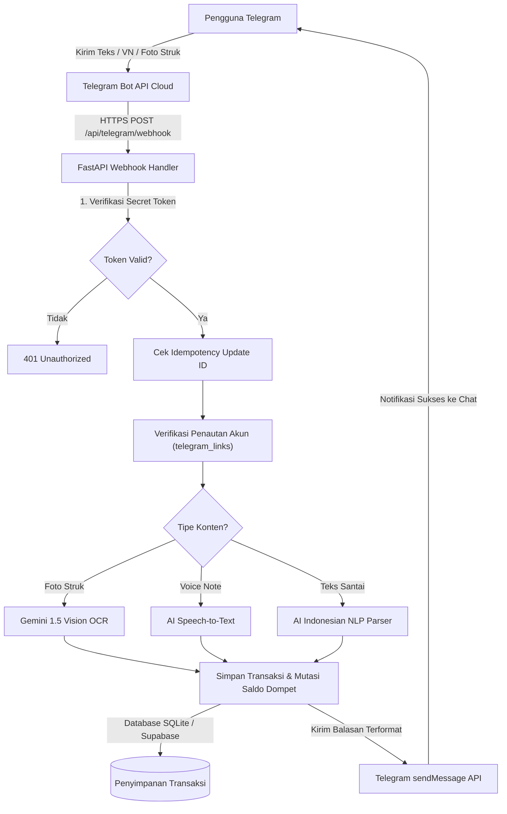
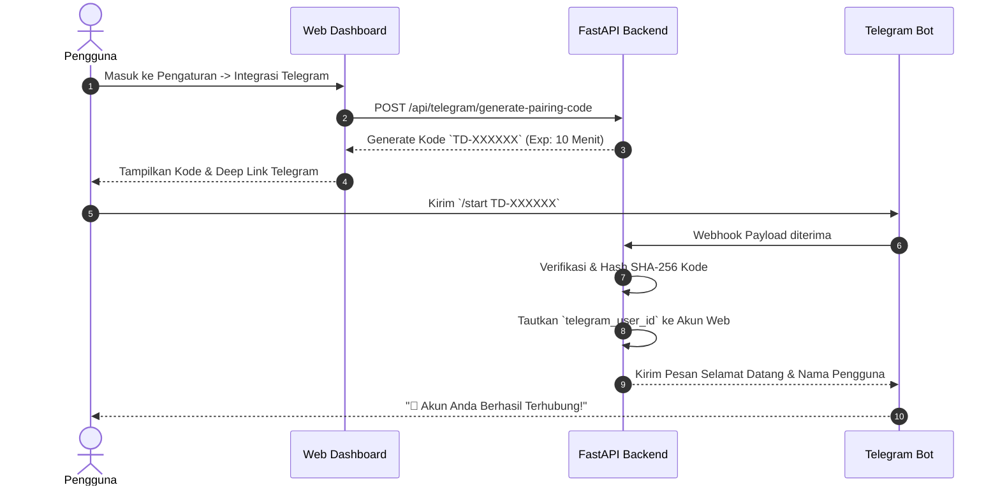

# 🍊 TataDana — Smart Personal Finance SaaS via Telegram & Web Dashboard

<div align="center">


**Catat pengeluaran semudah kirim chat — langsung dari Telegram kamu.**  
*Solusi pembukuan keuangan pribadi modern berbasis AI: Teks natural, Voice Note, & Scan Struk Belanja.*

[Fitur Utama](#-fitur-utama) • [Arsitektur & Diagram](#-arsitektur--diagram-alur) • [Tech Stack](#-tech-stack) • [Instalasi Lokal](#-panduan-instalasi-lokal) • [Environment Variables](#-konfigurasi-environment-variables) • [Panduan Webhook](#-panduan-webhook-telegram-production) • [Test Suite](#-pengujian--verifikasi-kualitas)

</div>

---

## 📌 Ringkasan Proyek

**TataDana** adalah platform SaaS manajemen keuangan pribadi inovatif yang menghubungkan kemudahan antarmuka chat **Telegram** dengan keandalan backend modern **FastAPI** dan **Supabase**. 

Pengguna tidak perlu lagi repot membuka aplikasi rumit untuk mencatat tiap cangkir kopi atau struk supermarket. Cukup ketik pesan singkat (misal: `Beli bensin 25k`), kirim pesan suara (*Voice Note*), atau foto struk belanjaan (*AI Vision OCR*). Sistem secara otomatis mengklasifikasikan kategori, mengupdate saldo dompet, memantau batas budget bulanan, dan menyinkronkan seluruh data ke dashboard analitik web secara real-time.

---

## ✨ Fitur Utama

### 1. 🤖 Integrasi Bot Telegram Webhook Berkecepatan Tinggi
- **Idempotent Webhook Processing:** Mencegah pencatatan transaksi ganda akibat retry webhook jaringan.
- **Header Secret Validation:** Setiap payload diverifikasi menggunakan `X-Telegram-Bot-Api-Secret-Token` untuk mencegah akses tidak sah.
- **Multi-Command Bot:**
  - `/saldo` — Cek saldo seluruh dompet aktif (Cash, Bank, E-Wallet).
  - `/hari_ini`, `/minggu_ini`, `/bulan_ini` — Rekapitulasi transaksi otomatis dengan agregasi nominal.
  - `/budget` — Indikator visual progres budget per kategori.
  - `/bantuan` — Panduan sintaks perintah interaktif.

### 2. 🧠 AI Natural Language & Vision Parsing (Google Gemini)
- **Ekstraksi Teks Bahasa Indonesia:** Memahami format santai seperti `15rb`, `25ribu`, `1.5jt`, `50k`, `300rb`.
- **AI OCR Struk Belanja (Pro Feature):** Ekstraksi otomatis nama merchant, tanggal transaksi, itemisasi belanjaan, subtotal, pajak/diskon, dan total belanja menggunakan model Vision.
- **Voice Note Transcriber (STT):** Mendukung pencatatan cepat via rekaman suara hingga 60 detik.
- **Multi-Provider AI & Failover Mode:** Mendukung fallback otomatis antara Google Gemini, OpenAI GPT, dan DeepSeek melalui konfigurasi Admin Dashboard.

### 3. 📊 Dashboard Finansial Web Interaktif
- **Multi-Wallet Management:** Pisahkan pencatatan antara Dompet Tunai, Tabungan Bank, dan E-Wallet (GoPay, OVO, ShopeePay).
- **Visual Budget Progress Bar:** Peringatan visual otomatis saat pengeluaran mendekati atau melampaui limit anggaran bulanan.
- **Transfer Antar-Dompet:** Rekonsiliasi mutasi internal tanpa merusak grafik arus kas pengeluaran riil.
- **Chart.js Analytics:** Visualisasi distribusi kategori dan tren pengeluaran bulanan.

### 4. 📄 Export Laporan Otomatis (PDF & Excel)
- **Ekspor Dokumen Cepat:** Dibuat menggunakan ReportLab (PDF formal dengan layout akuntansi) dan OpenPyXL (Excel `.xlsx` siap olah).
- **Supabase Storage Integration:** Hasil ekspor disimpan di bucket cloud terenkripsi dengan signed URL unduh yang aman.

### 5. 🛡️ Keamanan & Arsitektur Multi-Tier SaaS
- **Sistem Penautan Akun Aman (One-Time Pairing Token):** Akun Telegram dihubungkan menggunakan token unik bertenggat waktu 10 menit (SHA-256) tanpa pernah meminta password pengguna di chat.
- **Role-Based Access Control:** Memisahkan hak akses Pengguna Umum dan Administrator.
- **Starter vs Pro Tier Enforcement:** Proteksi kuota transaksi bulanan, batas jumlah dompet, dan akses eksklusif fitur AI OCR struk belanja.

---

## 🏛️ Arsitektur & Diagram Alur

### Arsitektur Aliran Transaksi Telegram Webhook



### Alur Penautan Akun Aman (One-Time Pairing Token)



---

## 💻 Tech Stack

| Kategori | Teknologi | Deskripsi |
| :--- | :--- | :--- |
| **Backend Framework** | [FastAPI](https://fastapi.tiangolo.com/) (Python 3.11+) | Async ASGI framework berkecepatan tinggi dengan auto docs Swagger UI |
| **Server Engine** | [Uvicorn](https://www.uvicorn.org/) | Server ASGI standar industri untuk lingkungan kontainer |
| **Database** | [Supabase](https://supabase.com/) (PostgreSQL) / SQLite | Relational database dengan Row-Level Security dan Fallback Lokal |
| **Enkripsi & Keamanan** | [Cryptography (Fernet)](https://cryptography.io/) & Argon2 | Enkripsi simetris token pihak ketiga dan hashing password pengguna |
| **AI Vision & NLP** | [Google Gemini 1.5 Flash](https://ai.google.dev/) | Ekstraksi teks struk belanjaan dan ekstraksi entitas transaksi alami |
| **Frontend Dashboard** | Jinja2, Tailwind CSS, Plus Jakarta Sans | UI clean bertema modern fintech (*Orange & White Slate*) |
| **Data Visualization** | [Chart.js](https://www.chartjs.org/) | Visualisasi grafik interaktif arus kas dan kategori pengeluaran |
| **Document Generator**| [ReportLab](https://www.reportlab.com/) & [OpenPyXL](https://openpyxl.readthedocs.io/) | Ekspor mutasi transaksi ke PDF formal dan lembar kerja Excel |
| **Deployment Cloud** | [Railway](https://railway.app/) / [Render](https://render.com/) | Cloud PaaS container terintegrasi Procfile dan auto-redeploy GitHub |

---

## 📦 Paket Layanan: Starter vs Pro

| Fitur Unggulan | Paket Starter (Gratis / Standar) | Paket Pro (Rp99.000 Sekali Bayar) |
| :--- | :---: | :---: |
| **Batas Transaksi** | Maksimal 50 transaksi / bulan | **Unlimited (Tanpa Batas)** |
| **Batas Dompet** | Maksimal 3 dompet aktif | **Unlimited** |
| **Kategori Budget** | Maksimal 5 kategori anggaran | **Unlimited** |
| **Pencatatan Teks & VN** | ✅ Termasuk (Maks VN 60 detik) | ✅ Termasuk (Maks VN 60 detik) |
| **Scan Struk AI Vision (OCR)** | 🔒 Terkunci (Perlu Upgrade) | ✅ **Aktif Otomatis** |
| **AI Financial Advisor** | 🔒 Terkunci | ✅ **Aktif Otomatis** |
| **Export Laporan PDF & Excel** | 🔒 Ringkasan saja | ✅ **Akses Lengkap & Download** |
| **Notifikasi & Reminder Harian** | ✅ Hingga 2x sehari | ✅ Kustomisasi Jadwal |

---

## 🚀 Panduan Instalasi Lokal

Ikuti langkah-langkah berikut untuk menjalankan TataDana di lingkungan komputer lokal Anda:

### 1. Prasyarat Sistem
- **Python**: Versi 3.11 atau lebih baru (`python --version`)
- **Git**: Terpasang di komputer (`git --version`)
- **Akun Telegram**: Untuk membuat bot via [@BotFather](https://t.me/botfather)

### 2. Kloning Repositori
```bash
git clone https://github.com/hanzzfeeder-png/tatadana.git
cd tatadana
```

### 3. Buat dan Aktifkan Virtual Environment
- **Windows (PowerShell):**
  ```powershell
  python -m venv venv
  .\venv\Scripts\activate
  ```
- **macOS / Linux:**
  ```bash
  python3 -m venv venv
  source venv/bin/activate
  ```

### 4. Instalasi Dependensi
```bash
pip install --upgrade pip
pip install -r requirements.txt
```

### 5. Konfigurasi Environment Variables
Salin template konfigurasi `.env.example` ke file `.env`:
```bash
cp .env.example .env
```
Buka file `.env` dan lengkapi konfigurasi minimal Anda (lihat bagian [Konfigurasi Environment Variables](#-konfigurasi-environment-variables) di bawah).

### 6. Menjalankan Aplikasi
```bash
python run.py
```
Aplikasi akan aktif di:
- **Web App Dashboard:** [http://localhost:8000](http://localhost:8000)
- **Dokumentasi API Swagger UI:** [http://localhost:8000/docs](http://localhost:8000/docs)
- **Dokumentasi ReDoc:** [http://localhost:8000/redoc](http://localhost:8000/redoc)

---

## ⚙️ Konfigurasi Environment Variables

Berikut adalah daftar variabel lingkungan yang didukung oleh sistem:

| Variabel | Tipe | Contoh / Default | Deskripsi |
| :--- | :---: | :--- | :--- |
| `APP_NAME` | String | `TataDana` | Nama aplikasi yang ditampilkan di header |
| `APP_ENV` | String | `development` / `production` | Mode lingkungan aplikasi |
| `DEBUG` | Boolean | `True` / `False` | Mode debug FastAPI |
| `PORT` | Integer | `8000` | Port listen aplikasi lokal / cloud |
| `HOST` | String | `0.0.0.0` | Host binding interface server |
| `SECRET_KEY` | String | *(Random 32+ Karakter)* | Kunci rahasia hashing session token JWT |
| `ENCRYPTION_KEY` | String | *(Fernet 32-byte Base64)* | Kunci enkripsi simetris token bot di database |
| `WEBHOOK_BASE_URL` | URL | `https://your-domain.up.railway.app` | Base domain HTTPS server publik |
| `APP_TIMEZONE` | String | `Asia/Jakarta` | Zona waktu operasional (WIB) |
| `TELEGRAM_BOT_TOKEN` | Secret | `8571786434:AAH...` | Token HTTP API bot dari BotFather |
| `TELEGRAM_WEBHOOK_SECRET` | Secret | *(String Acak Alfanumerik)* | Secret token pengaman webhook Telegram |
| `GEMINI_API_KEY` | Secret | `AIzaSy...` | Kunci Google AI Studio untuk OCR & NLP |
| `SUPABASE_URL` | URL | `https://xyz.supabase.co` | Endpoint project Supabase Anda |
| `SUPABASE_SERVICE_ROLE_KEY` | Secret | `eyJh...` | Kunci Service Role Supabase (Bypass RLS untuk background tasks) |
| `SUPABASE_STORAGE_BUCKET` | String | `tatadana-exports` | Nama bucket storage tempat menyimpan ekspor |
| `MIDTRANS_SERVER_KEY` | Secret | `SB-Mid-server-...` | Kunci server pembayaran Midtrans |
| `MIDTRANS_CLIENT_KEY` | Secret | `SB-Mid-client-...` | Kunci client pembayaran Midtrans |
| `MIDTRANS_IS_PRODUCTION` | Boolean | `False` | Mode sandbox (`False`) atau production (`True`) |

---

## 📡 Panduan Webhook Telegram Production

Setelah aplikasi di-deploy ke cloud hosting (misal Railway dengan domain `https://web-production-282ac.up.railway.app`), daftarkan endpoint webhook Telegram menggunakan script otomatis yang telah disediakan:

```bash
python scripts/set_production_webhook.py --url https://web-production-282ac.up.railway.app
```

Fitur script:
- Otomatis memanggil `https://api.telegram.org/bot<TOKEN>/setWebhook`
- Mendaftarkan endpoint: `/api/telegram/webhook`
- Menginjeksi parameter `secret_token` sesuai nilai `TELEGRAM_WEBHOOK_SECRET`
- Memverifikasi status aktif melalui `getWebhookInfo` secara instan

---

## 🧪 Pengujian & Verifikasi Kualitas

Proyek ini dilengkapi dengan rangkaian test suite otomatis yang mencakup pengujian unit skema database, kalkulasi saldo, otentikasi JWT, batasan paket Starter, NLP parser bahasa Indonesia, hingga end-to-end simulasi webhook Telegram:

Jalankan seluruh test suite menggunakan `pytest`:
```bash
pytest tests/ -v
```

Hasil verifikasi:
```text
tests/test_advanced_features.py ..............                       [ 22%]
tests/test_sql_schema_validator.py ......                            [ 31%]
tests/test_stage2_transactions_and_reports.py ........               [ 44%]
tests/test_stage3_telegram_webhook_and_pairing.py .........          [ 58%]
tests/test_stage4_user_dashboard.py ......                           [ 68%]
tests/test_stage5_admin_dashboard.py ........                        [ 80%]
tests/test_stage6_landing_page.py ....                               [ 87%]
tests/test_stage7_auth_onboarding.py ......                          [ 96%]
tests/test_stage8_e2e_verification.py ..                             [100%]

============================= 63 passed in 24.13s =============================
```

---

## 🔑 Kredensial Uji Coba (Demo)

Untuk keperluan eksplorasi dan demonstrasi fitur, Anda dapat menggunakan kredensial bawaan berikut:

| Akun | Email / Username | Password | Hak Akses |
| :--- | :--- | :--- | :--- |
| **Demo User** | `demo@tatadana.id` *(atau 081234567890)* | `demo123456` | Dashboard pengguna, transaksi, dompet, budget |
| **Super Administrator** | `admin@tatadana.id` | `admin123456` | Admin panel, audit logs, manajemen provider AI, approval pembayaran |

---

## 📁 Struktur Direktori Proyek

```text
tatadana/
├── app/
│   ├── api/                    # Endpoint router FastAPI (auth, wallets, transactions, telegram, admin)
│   ├── services/               # Logika bisnis (ai_service, telegram_service, wallet_service, budget_service)
│   ├── config.py               # Pengaturan konfigurasi pydantic & pembacaan environment
│   ├── database.py             # Inisialisasi koneksi SQLite / PostgreSQL & skema tabel
│   ├── main.py                 # Titik masuk utama aplikasi FastAPI & middleware
│   └── security.py             # Enkripsi password, verifikasi JWT, & otorisasi user
├── scripts/
│   ├── git_helper.py           # Helper utilitas repository
│   └── set_production_webhook.py # Helper otomatis pendaftaran webhook Telegram
├── static/                     # Aset statis (CSS, Tailwind, JavaScript, Icon)
├── templates/                  # Template HTML Jinja2 (Landing page, Auth, Dashboard, Admin)
├── supabase/migrations/        # Berkas migrasi skema SQL Supabase & RLS policies
├── tests/                      # Rangkaian 63 unit test dan verifikasi E2E
├── Procfile                    # Spesifikasi perintah runtime container cloud
├── requirements.txt            # Daftar library Python dependensi proyek
├── run.py                      # Skrip runner lokal aplikasi
├── DEPLOYMENT_GUIDE.md         # Panduan rilis cloud (Railway & Render)
└── README.md                   # Dokumentasi resmi proyek
```

---

## 📄 Lisensi

Proyek ini dilisensikan di bawah lisensi **MIT License** — Anda bebas menggunakannya untuk keperluan personal maupun pengembangan komersial.

---

<div align="center">
  <sub>Dibangun dengan ❤️ oleh Tim Pengembang TataDana. Dikembangkan untuk kemudahan finansial masyarakat Indonesia.</sub>
</div>
